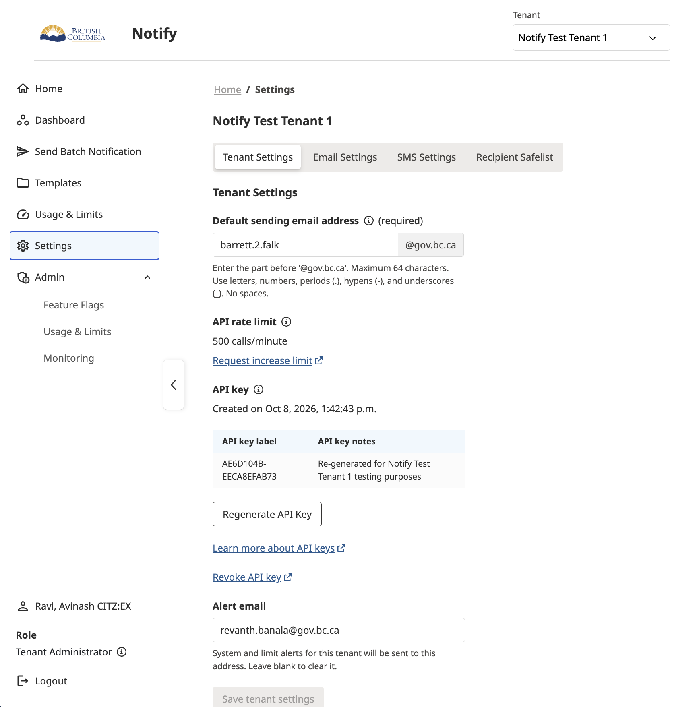
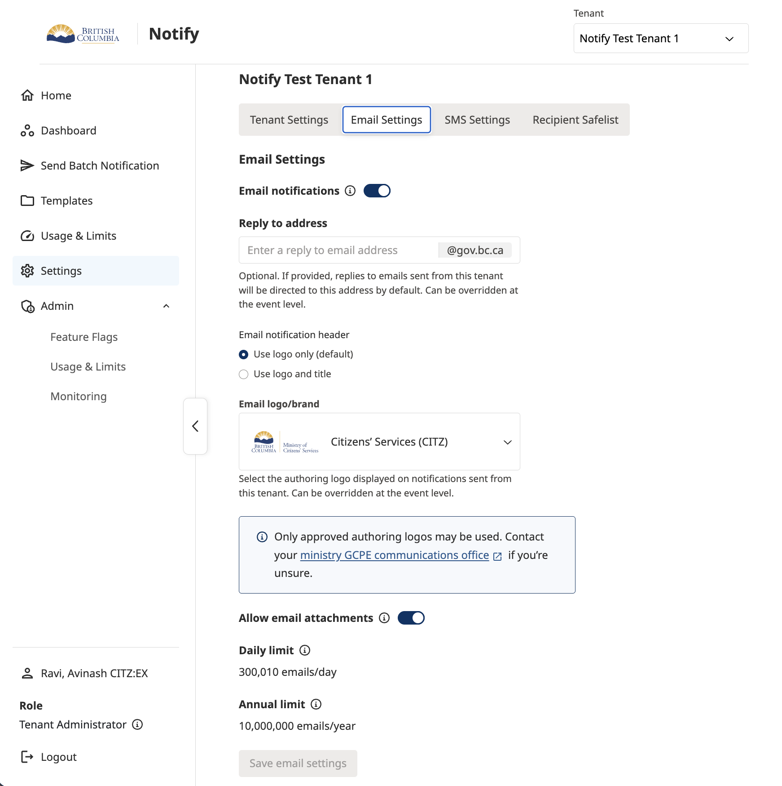
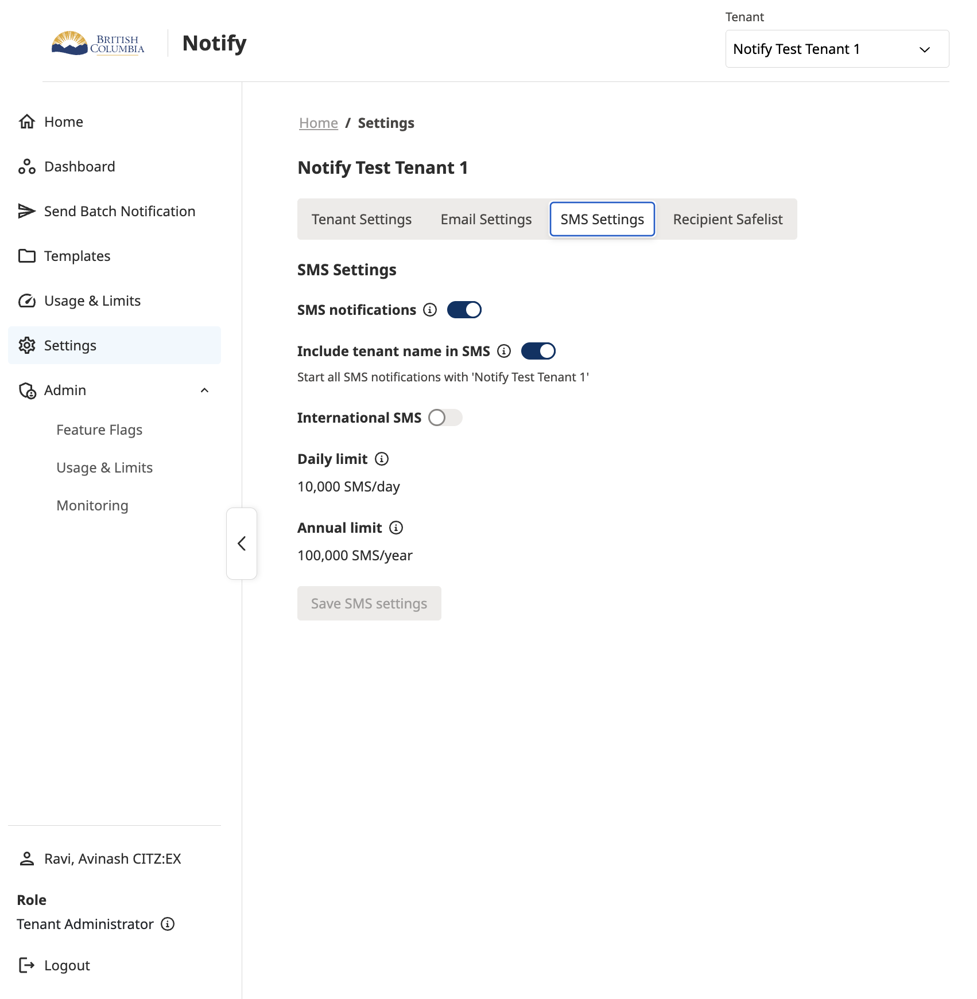
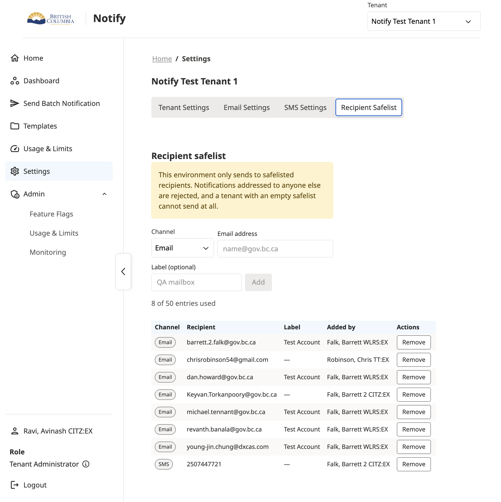
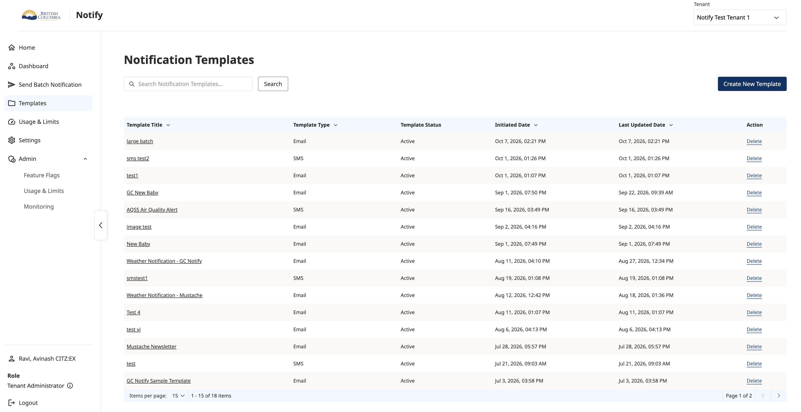
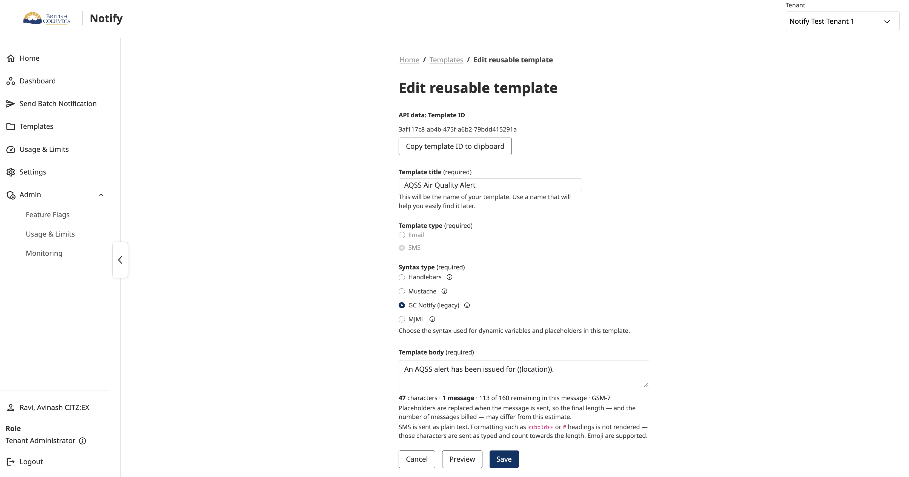
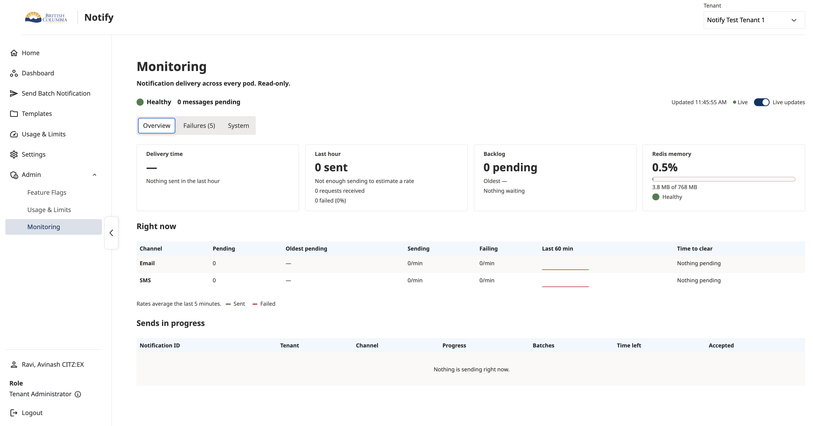
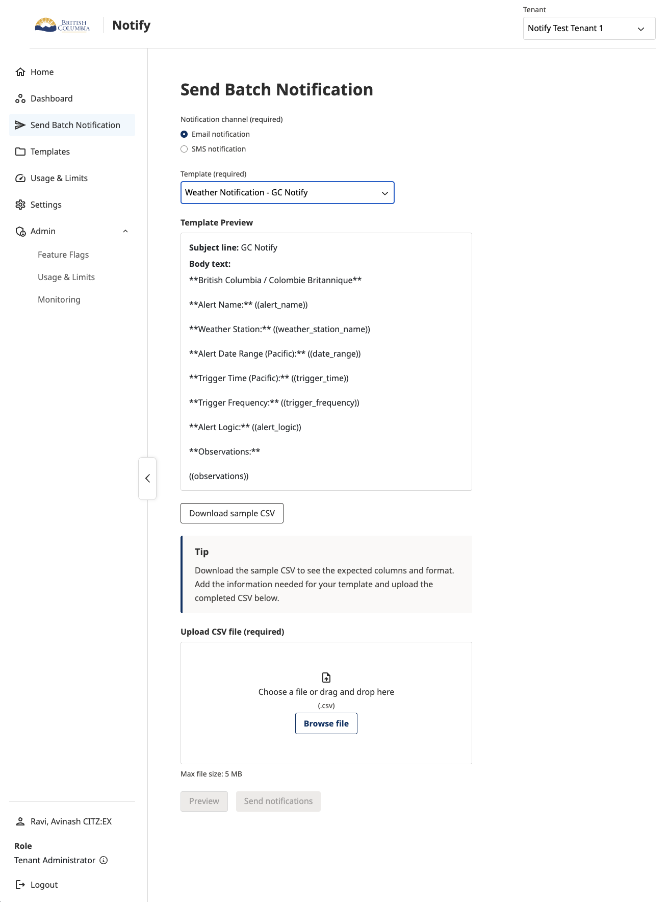

# UI
The Notify user interface allows users to configure tenant settings, manage notification event types, configure services and maintain notification templates.

The pages and actions available to a user depend on the selected tenant, the user's assigned permissions and the features currently available in Notify.

This guide describes the main pages in the interface and how to use them.

## Tenant Settings

The Tenant Settings page allows users to view and manage configuration for the selected tenant.

Tenant settings define the default configuration used when processing notifications. Depending on the options available to the tenant, these settings may include email and SMS providers, sender details, templates, subscription services and callback configuration.

1. Using Tenant Settings
2. Sign in to Notify.
3. Select the tenant you want to work with.
4. Navigate to Tenant Settings.
5. Review the available configuration sections.
6. Select the relevant setting to view or update its values.
7. Save your changes.

The available settings and editing options depend on the tenant configuration and the user's permissions.

## Event Types

Event types define the configuration for different notification scenarios, including default channels, recipients, templates and message content.

This feature is still under construction.

## Configuring Services

Services allow Notify to connect with external systems to support tasks such as resolving recipients, rendering notification content and generating attachments.

This feature is still under construction

## Administering Services
Service administration allows users to manage services configured for their tenant.

This feature is still under construction

## Managing Templates

The Templates page allows users to view, search and manage reusable email and SMS notification templates for the selected tenant. The page displays the template title, type, status, creation date, last updated date and available actions.

Users can create new templates or select an existing template to view or edit its details. Templates include a title, template type, subject line for email templates, syntax type and message body. Users can preview the template before saving their changes.

Templates support different syntax types, including Handlebars, Mustache, GC Notify (legacy) and MJML.

## Monitoring and Diagnostics

The Monitoring page provides a read-only view of notification delivery and system health across pods.

The Overview tab displays system health, pending messages, delivery times, recent sending activity, backlog and Redis memory usage. It also shows the status of email and SMS channels, including pending, sending and failing rates, and notifications currently in progress.

The page also includes Failures and System tabs for additional monitoring information. Live updates can be enabled or disabled.

## Sending Mail Merge

The Send Batch Notification page allows users to send personalised email or SMS notifications to multiple recipients using a template and a CSV file.

Users select the notification channel and template, then download a sample CSV showing the expected format. The CSV contains columns matching the placeholders in the selected template, with each row providing the values to populate those placeholders for a recipient.

Users upload the completed CSV file, preview the notifications and select Send notifications to submit them.

